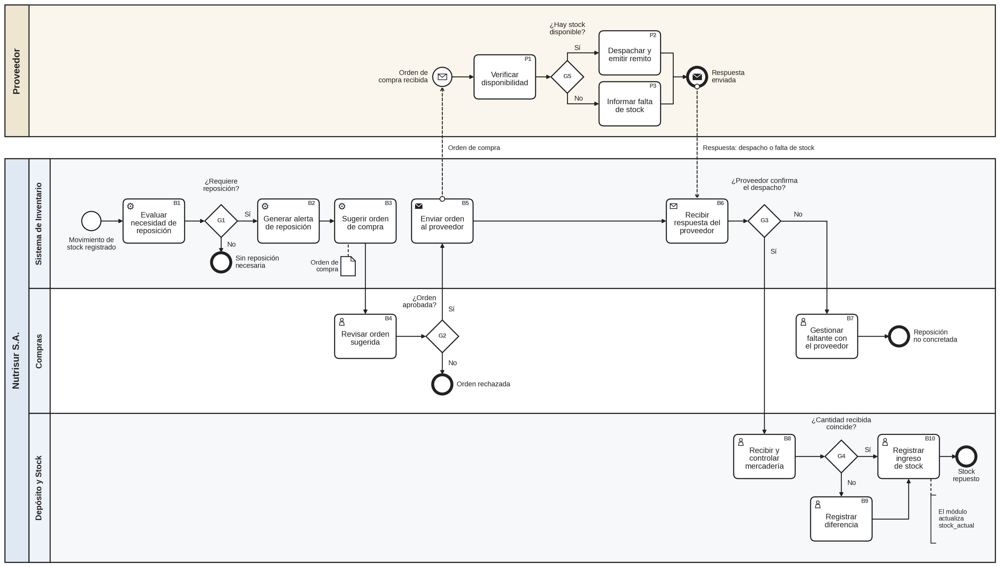
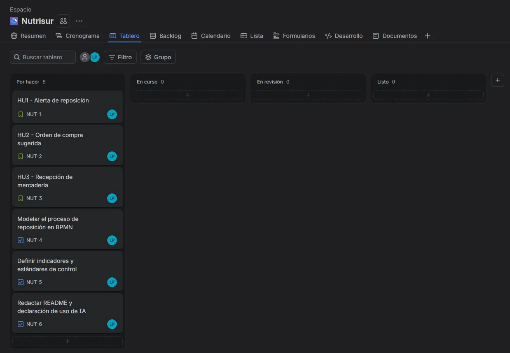
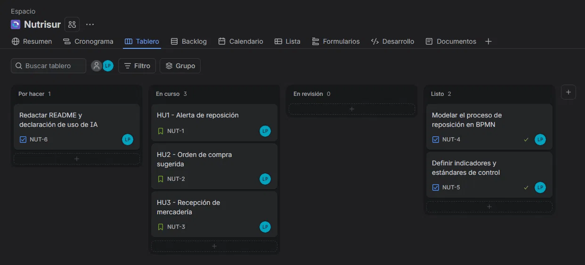
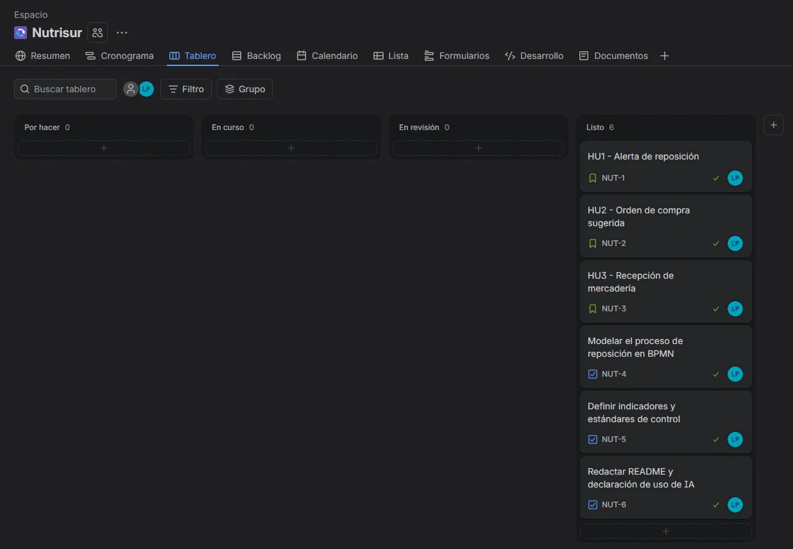

# Nutrisur S.A. - Módulo de Gestión de Inventario y Reposición

Trabajo Práctico Integrador y Progresivo de Organización Empresarial.
Tecnicatura Universitaria en Programación - Universidad Tecnológica Nacional.

## Enlaces

- **Repositorio:** https://github.com/SoyEZZEK/nutrisur-gestion-inventario
- **Tablero de gestión (Jira):** https://lautaroperezequiel17.atlassian.net/jira/software/projects/NUT/boards/2?filter=&groupBy=none

## Descripción del sistema

Nutrisur S.A. es una empresa ficticia dedicada a la distribución mayorista de productos alimenticios envasados (almacén, kiosco y bazar). Actúa como intermediaria entre fabricantes y comercios minoristas, en un rubro de márgenes reducidos y alta rotación, donde el control del inventario incide directamente en la rentabilidad.

El sistema propuesto es un Módulo de Gestión de Inventario y Reposición que:

- registra el stock de cada producto en tiempo real (ingresos, egresos y ajustes);
- emite alertas automáticas cuando un producto llega a su punto de pedido;
- sugiere órdenes de compra a proveedores a partir del histórico de ventas;
- descuenta el stock al momento de la facturación y genera reportes de rotación.

El objetivo general es reducir los quiebres de stock y el capital inmovilizado.

## Integrante y docentes

- **Alumno:** Pérez, Lautaro Ezequiel
- **Docente titular:** López, Mario Raúl
- **Docente tutor:** Corts Romeo, Franco Nicolás

## Contenido del repositorio

| Carpeta o archivo | Contenido |
|---|---|
| `docs/` | Informes de las Entregas 1, 2 y 3 (enfoque sistémico, planeación y estructura formal). |
| `datos/diccionario-datos.md` | Diccionario de datos de Producto, Movimiento de stock, Proveedor y Orden de compra. |
| `bpmn/` | Diagrama BPMN del proceso de reposición de stock y su descripción. |
| `backlog/historias-de-usuario.md` | Historias de usuario HU1 a HU3 con criterios de aceptación. |
| `control/indicadores.md` | Indicadores y estándares de desempeño. |
| `evidencias/` | Capturas del tablero de Jira en distintos momentos del proyecto. |

## Proceso modelado (BPMN)

El proceso modelado es la reposición de stock: desde que un producto llega a su punto de pedido hasta que la mercadería repuesta queda registrada en el inventario. Tiene dos pools (Nutrisur S.A. y Proveedor), tres lanes (Sistema de Inventario, Compras y Depósito y Stock) y compuertas para las excepciones: sin reposición necesaria, orden rechazada, proveedor sin stock y diferencia en la recepción.

La descripción de actividades y compuertas está en [bpmn/descripcion-proceso.md](bpmn/descripcion-proceso.md).

## Gestión del proyecto en Jira

El backlog se administra en un tablero Scrum de Jira con las columnas Por hacer, En curso, En revisión y Listo. Las tres historias de usuario se definieron con el formato "Como [usuario], quiero [funcionalidad], para [beneficio]":

| Clave | Historia | Prioridad |
|---|---|---|
| NUT-1 | HU1 - Alerta de reposición | Alta |
| NUT-2 | HU2 - Orden de compra sugerida | Alta |
| NUT-3 | HU3 - Recepción de mercadería | Media |

El trabajo del repositorio se gestionó con tres tareas: NUT-4 (modelar el proceso en BPMN), NUT-5 (definir indicadores y estándares de control) y NUT-6 (README y declaración de uso de IA).

Una historia se considera lista cuando sus actividades están modeladas en el diagrama BPMN y la documentación correspondiente está integrada al repositorio mediante un Pull Request.

Evolución del tablero:

1. Inicio, con todas las actividades en Por hacer.
   
2. Historias en curso, con el BPMN y los indicadores terminados.
   
3. Historias completadas.
   

Las ramas llevan la clave de la actividad de Jira (por ejemplo `NUT-4-bpmn-reposicion`) y los mensajes de commit la incluyen al final, para relacionar el trabajo del repositorio con el tablero.

## Flujo de trabajo en Git

- La rama `main` contiene la versión integrada. Cada bloque de trabajo se desarrolla en una rama secundaria y se incorpora mediante un Pull Request.
- Los mensajes de commit siguen el formato `tipo: descripción`, con tipos como `docs` y `docs(bpmn)`.

| Rama | Contenido |
|---|---|
| `docs/entregas-previas` | Informes de las Entregas 1, 2 y 3. |
| `docs/diccionario-datos` | Diccionario de datos. |
| `NUT-4-bpmn-reposicion` | Diagrama BPMN y su descripción. |
| `NUT-1-historias-usuario` | Historias de usuario. |
| `NUT-5-indicadores` | Indicadores y estándares de control. |
| `NUT-6-readme-final` | README, evidencias y declaración de uso de IA. |

Por tratarse de un trabajo individual y por indicación docente, los Pull Requests fueron integrados por el propio autor, sin revisión de pares.

## Mecanismos de control

Se definieron seis indicadores con su estándar, medición y acción correctiva. Cuatro corresponden a las metas M1 a M4 de la Entrega 2 y dos controlan el proceso de reposición.

| ID | Indicador | Estándar |
|---|---|---|
| I1 | Tiempo de respuesta de la consulta de stock (percentil 95) | 2 segundos o menos |
| I2 | Capacidad de carga | 5.000 productos y 100.000 movimientos por mes |
| I3 | Calidad del software | 0 defectos críticos y 90 % o más de casos aprobados |
| I4 | Quiebres de stock | Reducción de 30 % o más en 6 meses |
| I5 | Alertas de reposición emitidas | 100 % |
| I6 | Cumplimiento del plazo de reposición | Plazo del proveedor más 2 días o menos, en el 90 % de las órdenes |

El detalle está en [control/indicadores.md](control/indicadores.md).

## Declaración de uso de IA

Para este trabajo usé Claude (Anthropic) como herramienta de asistencia. Lo utilicé para organizar la estructura de los informes a partir de las consignas, para redactar borradores de las secciones, para generar el diagrama BPMN y los archivos de documentación del repositorio a partir del proceso definido, y para proponer una primera versión de las historias de usuario y de los indicadores.

Las decisiones del proyecto son mías: elegí el proceso de reposición de stock para modelar, definí la herramienta de gestión (Jira), creé el repositorio y el tablero, realicé los commits y los Pull Requests, y moví las actividades del tablero según el avance real. Durante la revisión se corrigieron inconsistencias del material generado. También se incorporó al diccionario la entidad Orden de compra, que el proceso necesitaba y que la Entrega 3 no incluía. El contenido final fue revisado y ajustado por mí.
